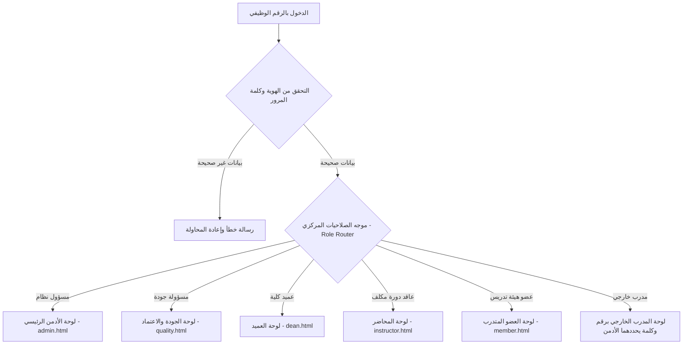

# وثيقة المواصفات الهندسية الشاملة ومسارات العمل (Master SRS & Architecture)
## منصة التطوير والتدريب المهني لأعضاء هيئة التدريس — جامعة الزرقاء (ZU-LMS)
**الإصدار:** 2.7 — انطلاق التنفيذ 26 أكتوبر 2026  
**تاريخ التحديث:** 26 أكتوبر 2026  
**المرجعية:** توجيهات رئاسة الجامعة وضمان الجودة والاعتماد الأكاديمي  
**الهوية البصرية:** الأبيض الملكي (`#FFFFFF`, `#F8FAFC`) + كحلي جامعة الزرقاء الرسمي (`#022C5A`)

**مرجع التنفيذ القادم:** قرارات هذا الإصدار تتقدم على بروتوتايب المراجعة v2.3 حيث يختلفان. تُوثق هنا فقط بناءً على طلب صاحب المتطلبات، ولا يُعدّل البروتوتايب لهذه الدفعة من القرارات.

## القرارات التشغيلية المعتمدة — 21 أكتوبر 2026

تعلو هذه القرارات على الصياغات السابقة المتعارضة:

1. نسبة الحضور النهائية = عدد المحاضرات التي حضرها المتدرب ÷ العدد النهائي لمحاضرات الدورة × 100. الحد الأدنى 75%؛ في دورة من 10 محاضرات، حضور 7 = 70% ورسوب، وحضور 8 = 80% واستيفاء شرط الحضور. الحد الأدنى لعدد المحاضرات هو تقريب (0.75 × العدد النهائي) إلى العدد الصحيح الأعلى. أثناء الدورة يظهر مؤشر مبدئي، ولا يصدر حكم رسوب نهائي قبل انتهائها. تضاف إلى الحضور شروط نجاح الامتحان إن وجد، وإكمال التقييم، واعتماد الأثر للشهادة وفق قرارات 25 أكتوبر.
2. ترشيح المحاضر والتواصل مع المشاركين المحتملين يتمان من العميد خارج المنصة. **الجودة تختار المشاركين المحددين بالاسم وتضيفهم وحدها إلى سجل الدورة**؛ لا يرسل العميد قائمة أسماء في المقترح ولا يضيفهم بنفسه، ولا توجد خطوة قبول أو رفض منهم داخل الفلو. يمكن التسجيل الذاتي في الدورات المطروحة المؤهلة حسب قرار 25 أكتوبر. اعتماد الجودة للدورة يبقى مطلوباً.
3. الدخول أول مرة بالرقم الوظيفي وكلمة المرور الأولية التي ترسلها المنصة بالبريد بعد أمر الأدمن، أو الكلمة الأولية المشتركة البديلة، ثم تغيير إلزامي لكلمة المرور. يعتمد الدخول اللاحق الرقم الوظيفي وكلمة المرور الجديدة. لا تُطلب إعادة التغيير في كل دخول.

## قرارات صاحب المتطلبات — 25 أكتوبر 2026

تعلو هذه القرارات على أي صياغة سابقة متعارضة في الوثيقة:

1. التسجيل الذاتي متاح لدورات كلية العضو المطروحة له، وكذلك الدورات العامة التي تطرحها دائرة الجودة لجميع الكليات. إذا كانت الدورة للمشاركين المحددين بالاسم، **تختارهم وتضيفهم الجودة وحدها** ويقتصر الاشتراك عليهم دون تسجيل ذاتي للآخرين؛ يتواصل العميد معهم خارج المنصة ولا يقدم قائمة أسماء لإضافتها في مقترح الدورة.
2. ينهي المحاضر الدورة بإجراء صريح «إنهاء الدورة». لا يمكن إضافة محاضرات بعد هذا الإجراء. يمكنه تصحيح حضور محاضرة سابقة حتى بعد إصدار الشهادة، ويعيد النظام تقييم استحقاق الشهادة بعد التصحيح. إذا فُقد الاستحقاق، تُلغى الشهادة ويظهر أنها ملغاة عند التحقق.
3. إذا لم يعتمد المحاضر ملف الأثر، يعيده إلى العضو للتعديل؛ ويرفع العضو نسخة جديدة معدلة. يمكن تكرار الإعادة والرفع حتى الاعتماد، ولا يعاد رفع الملف نفسه كما هو.
4. يحدد العميد في مقترح الدورة، أو الجودة عندما تنشئ دورة بنفسها، هل الدورة مشروطة بامتحان خارجي. يجري المحاضر الامتحان خارج المنصة ويسجل فيها النتيجة «ناجح/راسب» فقط؛ لا تدير المنصة أسئلته أو موعده أو طريقته. النجاح شرط لإتاحة الاستبيان والشهادة في دورة الامتحان، ويُتجاوز الشرط في الدورة بلا امتحان. يستطيع الأدمن والجودة تعديل وجود الشرط، لكن لا تستطيع الجودة إزالته بعد تسجيل أي نتيجة نشطة؛ يعطل الأدمن النتائج منطقياً أولاً ثم يحول الدورة إلى «بلا امتحان»، ويعاد تقييم الاستحقاق والإصدار آلياً. إذا عاد الشرط لاحقاً، يلزم رصد نتائج جديدة ولا تُستعاد النتائج القديمة تلقائياً.
5. **استُبدل قرار الحذف الجذري بقرار 26 أكتوبر 2026:** يمتلك الأدمن صلاحية تعطيل أي كيان مهما كانت حالته بعد تحذير واضح، مع بقاء السجل في قاعدة البيانات. إلغاء العميد لدورة معتمدة يتطلب موافقة الجودة، ثم تُؤرشف بوصفها ملغية مع سجلاتها.
6. البنود الواردة في القسم 14 توصيات مؤجلة، وليست ضمن نطاق التنفيذ المعتمد حالياً.

### أولوية قرار 26 أكتوبر بشأن الحذف

ألغي الحذف الجذري من نطاق النظام. لكل كيان قابل للحذف حالة حذف منطقي مستقلة عن حالة الأرشفة؛ لا تُزال سجلاته من قاعدة البيانات. عند تعطيل الأدمن دورة لها شهادات، يسأله النظام هل يترك شهاداتها للأعضاء أم يعطلها أيضاً. إذا اختار تعطيل الشهادات، تُخفى من بوابة التحقق ولا تظهر تفاصيلها؛ تبقى بياناتها في قاعدة البيانات.

## قرارات صاحب المتطلبات — 26 أكتوبر 2026

تعلو هذه القرارات على البنود التقنية والتشغيلية السابقة المتعارضة:

1. التنفيذ المستقبلي بـ **.NET 10 / ASP.NET Core** وفق **Clean Architecture** ومبادئ **SOLID**، مع **Entity Framework Core** بدلاً من Dapper، و**PostgreSQL** بدلاً من SQL Server، والنشر على خادم Ubuntu.
2. الواجهة بـ **Bootstrap 5 وjQuery وAJAX**؛ تنفذ التحققات على العميل قبل الإرسال، ويعيد الخادم التحقق من كل مدخل وكل صلاحية. يعتمد الدخول **JWT**، دون تسجيل ذاتي للحسابات، مع «تذكرني» واستعادة كلمة المرور عبر البريد الجامعي.
3. بيانات الموظفين والأقسام والكليات تُستورد من واجهات الجامعة إلى قاعدة المنصة. تقرأ واجهات المنصة التشغيلية من قاعدة المنصة، ويملك الأدمن زر تحديث يستجلب الإضافات والتغييرات. اختفاء سجل من استجابة المصدر لا يعطله تلقائياً؛ يعرض للأدمن للمراجعة والقرار.
4. تحفظ كلمات المرور **بتشفير قابل لفك التشفير**، ويستطيع الأدمن البحث بالاسم أو رقم الدخول وعرض الكلمة الأولية الشخصية للموظف والكلمة الحالية وتغييرها بنفسه. تُرسل بيانات دخول الموظفين الأولية في بريد منسق بأمر يدوي من الأدمن عند جاهزية النظام؛ لا يعاد الإرسال لمن سُجّل نجاح الإرسال إليه. توجد كلمة مرور أولية مشتركة يضبطها الأدمن كبديل **لحسابات الموظفين قبل إكمال أول دخول**، سواء أُرسل لها البريد الشخصي أم لم يُرسل. للمدرب الخارجي مسار استثنائي موضح في القسم 8. هذا قرار صريح من صاحب المتطلبات عالي المخاطر الأمنية.
5. يوجد جدول قابل لإدارة الأدمن لسياسة كلمات المرور. تسري السياسة الجديدة عند إنشاء كلمة مرور أو تغييرها، ولا تفرض تغيير الكلمات الحالية لمجرد تعديل السياسة. لكل حقل ظاهر تلميح ديناميكي مخزن في قاعدة البيانات يمكن للأدمن إضافته وتعديله وحذفه، وتظهر التغييرات مباشرة في الواجهات.
6. تدعم الواجهات العربية والإنجليزية واتجاهي RTL/LTR، بواجهة **فاتحة فقط**. العربية إلزامية في حقول المحتوى، والإنجليزية اختيارية؛ عند غيابها يظهر النص العربي في العرض الإنجليزي. تُحفظ لغة المستخدم المفضلة، والافتراضي العربية. يضاف البحث لقوائم الأشخاص والبيانات الكبيرة، لا لكل قائمة قصيرة محدودة الخيارات. منتقي التاريخ والوقت مكوّن واجهة متوافق مع Bootstrap 5، وليس حقول التاريخ/الوقت الأصلية للمتصفح.
7. الحذف بواسطة الأدمن حذف منطقي، والأرشفة حالة مستقلة؛ يتحكم الأدمن في المستخدمين والدورات والأدوار والإعدادات والتفاصيل التشغيلية كافة، وتظل القيود الوظيفية الخاصة بسير إلغاء العميد وموافقة الجودة قائمة لغير الأدمن.
8. يستطيع الأدمن استعادة الكيان المعطل منطقياً؛ واستعادة الدورة تعيد شهاداتها التي أخفاها قرار تعطيل الدورة **للمستحقين فقط بعد إعادة تقييم الشروط**. يمنع المحاضر من إنهاء دورة بلا محاضرة واحدة على الأقل. تغيير نتيجة الامتحان إلى «راسب» بعد إصدار شهادة يلغي الشهادة ويرسل للعضو إشعاراً يوضح السبب؛ تعرض صفحته أنه مسجل في الدورة ولم يستوفِ متطلبات الشهادة، دون عرض شهادة ملغاة ضمن شهاداته.

### قرارات واجهة وصلاحيات لاحقة في 26 أكتوبر 2026

* الاحتياجات التدريبية يرفعها **العميد إلى الجودة فقط**؛ لا توجد شاشة رفع لها في حساب عضو هيئة التدريس.
* اللغة العربية حقل محتوى إلزامي، والإنجليزية اختيارية مع عرض العربية عند غياب الترجمة. المظهر فاتح فقط؛ أُلغي الوضع الداكن وتفضيله.
* البحث يوضع للقوائم الكبيرة مثل أعضاء هيئة التدريس، ولا يلزم للقوائم القصيرة ذات الخيارات المحدودة.
* مخططات الجلسات والحضور تخص **دورة محددة بوضوح**؛ يظهر اسم الدورة في عنوان المخطط وسياق الجلسات حتى لا يختلط «الجلسة الثانية» بين الدورات.
* نموذج تقييم الدورة **موحد على مستوى المنصة**، ولا يختلف من دورة لأخرى؛ يحرر أسئلته الأدمن والجودة فقط. تحتفظ التعديلات بنسخ منشورة حتى تبقى الإجابات والإحصاءات التاريخية قابلة للتفسير.
* شاشة تعديل المستخدم للأدمن تعرض كل صلاحيات العرض والإجراء الموروثة من الدور مع استثناء مستقل لكل صلاحية: **اتباع الدور / سماح / منع**، بما في ذلك الصلاحيات الدقيقة في كل الصفحات.
* الملف الشخصي المشترك يعرض بطاقات الشهادات الرسمية وبياناتها ورمز التحقق بتصميم واضح لمستخدمي المنصة جميعاً؛ تنزيل ملف PDF محصور بصاحب الشهادة.
* لكل محاضرة كود حضور من أربعة أرقام ينشأ معها، يفعّله المحاضر متى شاء لمدة خمس دقائق ويمكنه إعادة تفعيله؛ إدخاله الصحيح في خانة المحاضرة يحدد الحضور فوراً، ويستطيع المحاضر إضافة التحديد أو إزالته يدوياً. أُلغي نظام QR المزدوج للحضور.
* عند موافقة الجودة على إلغاء دورة، تُلغى صلاحية شهاداتها السابقة ويظهر إلغاؤها عند التحقق. الدورات التاريخية التي تدخلها الجودة تُصدر شهادات مباشرة للمستحقين، وليست أرشيفاً بلا شهادات.
* تحدد الجودة تاريخ نهاية فترة التقييم عند اعتماد الدورة، وتستطيع الجودة والأدمن تمديده عند الحاجة. نسخة النموذج الجديدة تسري على الدورة التي ما زالت فترة تقييمها مفتوحة؛ يعيد جميع المشاركين المؤهلين تقييمها بالنسخة الجديدة، حتى من أجاب على النسخة السابقة. إذا انتهت الفترة وأكمل الجميع تقييمهم، تبقى نتائج تلك الدورة على نسختها القديمة. إذا انتهت قبل اكتمال الإجابات، يُغلق الإدخال حتى تمديدها.
* يختار العميد محاضرًا من أعضاء كليته فقط عبر قائمة قابلة للبحث، أو يملأ بيانات محاضر خارجي. طلب محاضر من كلية أخرى يمر عبر الاحتياجات التدريبية إلى الجودة. في الدورة القصيرة تستطيع الجودة، سواء أنشأتها هي أو اقترحها العميد، إدارة الدورة بحسابها نيابةً عن المحاضر الفعلي دون إنشاء حساب خاص به؛ يظهر اسمه الحقيقي في التقييم والشهادة.
* للدورة المشروطة بامتحان **سجل امتحان واحد** ينشئه المحاضر بزر «إنشاء امتحان» ويسميه. يحدد لكل مشارك «ناجح» أو «راسب» صراحةً؛ مجرد ترك علامة النجاح فارغة لا يعني الرسوب. الامتحان نفسه يظل خارج المنصة.
* **تصميم الشهادة قالب PDF ثابت ينشئه ويرفعه الأدمن بزر مخصص متاح له في أي وقت.** عند إصدار شهادة، تطبع المنصة بيانات الدورة وصاحبها والمحاضر والرقم المرجعي وتاريخ الإصدار ورمز التحقق **فوق مواضع محددة على القالب الثابت**؛ القالب ليس PDF ذا حقول قابلة للتعبئة، ولا تعيد المنصة تصميمه لكل دورة. يقدم صاحب المتطلبات مواضع العناصر ليضبطها فريق التطوير برمجياً؛ لا يلزم محرر مرئي للمواضع ضمن شاشة الأدمن.

---

## فهرس المحتويات
1. [المبادئ التأسيسية وأولوية التعليمات](#1-المبادئ-التأسيسية-وأولوية-التعليمات)
2. [أنماط عقد البرامج التدريبية (الوجاهي، الأونلاين، والمدمج)](#2-أنماط-عقد-البرامج-التدريبية)
3. [آلية تسجيل الدخول وإدارة الهوية الرقمية (Authentication & Login Architecture)](#3-آلية-تسجيل-الدخول-وإدارة-الهوية-الرقمية)
4. [محرك صلاحيات مسؤول النظام الرئيسي (Super Administrator Core Engine - خاص)](#4-محرك-صلاحيات-مسؤول-النظام-الرئيسي-خاص)
5. [الهيكل الأكاديمي والتقسيمات (محاور التدريب، الكليات، والتخصصات)](#5-الهيكل-الأكاديمي-والتقسيمات)
6. [مصفوفة الأدوار والصلاحيات الموسعة (مع الطبيعة المزدوجة للمستخدمين)](#6-مصفوفة-الأدوار-والصلاحيات-الموسعة)
7. [دورة حياة الدورة التدريبية من منظور عميد الكلية وضوابط الترشيح](#7-دورة-حياة-الدورة-التدريبية-من-منظور-عميد-الكلية)
   - [أ. إنشاء الدورة وقاعدة حصر ترشيح المحاضر داخل الكلية](#أ-إنشاء-الدورة-وقاعدة-حصر-ترشيح-المحاضر-داخل-الكلية)
   - [ب. مسارات رد دائرة الجودة (قبول، طلب تعديل، رفض)](#ب-مسارات-رد-دائرة-الجودة)
   - [ج. آلية إلغاء الدورة بعد اعتمادها (كتاب الإلغاء الرسمي)](#ج-آلية-إلغاء-الدورة-بعد-اعتمادها)
8. [حلقة إدارة حسابات المدربين الخارجيين بين الجودة والأدمن](#8-حلقة-إدارة-حسابات-المدربين-الخارجيين-بين-الجودة-والأدمن)
9. [نظام "دوراتي كمحاضر" والتحول الديناميكي للأدوار](#9-نظام-دوراتي-كمحاضر-والتحول-الديناميكي-للأدوار)
10. [تسجيل الحضور لكل محاضرة بكود رقمي وسياسة نسبة 75%](#10-تسجيل-الحضور-لكل-محاضرة-بكود-رقمي-وسياسة-نسبة-75)
11. [صلاحيات المتدرب والمدرب ونظام رصد نتائج الامتحانات الخارجية](#11-صلاحيات-المتدرب-والمدرب-ونظام-رصد-نتائج-الامتحانات)
12. [صلاحيات وإدارة دائرة الجودة والاعتماد الموسعة](#12-صلاحيات-وإدارة-دائرة-الجودة-والاعتماد-الموسعة)
13. [نظام الأثر التدريبي وبوابة إصدار الشهادات الرقمية المشفرة](#13-نظام-الأثر-التدريبي-وبوابة-إصدار-الشهادات)
14. [التحسينات البرمجية الموصى بها لبيئة الإنتاج](#14-التحسينات-البرمجية-الموصى-بها-لبيئة-الإنتاج)
15. [المواصفات التقنية وبيانات التشغيل](#15-المواصفات-التقنية-وبيانات-التشغيل)
16. [قرارات لازمة قبل بدء البرمجة](#16-قرارات-لازمة-قبل-بدء-البرمجة)

---

## 1. المبادئ التأسيسية وأولوية التعليمات
1. **قاعدة الأولوية التشغيلية:** التعليمات والضوابط المحدثة في هذا الإصدار لها الأولوية المطلقة وتلغي أي بنود سابقة تتعارض معها.
2. **الفصل بين وثائق العرض والوثائق الإدارية:**
   * **وثيقة العرض الأكاديمي (`اليات و مخطط.txt`):** مخصصة للعرض على الدكاترة والعمداء، وتتضمن سير العمل الأكاديمي والتدريبي فقط دون التعرض لصلاحيات الأدمن الحساسة.
   * **وثيقة المواصفات الهندسية الشاملة (`PLATFORM_SPECIFICATION.md`):** تتضمن البنية التحتية الكاملة بما فيها صلاحيات مسؤول النظام الحساسة (Super Admin Privileges).
3. **الحوكمة والشفافية التامة:** لا يتم أي إلغاء لدورة معتمدة دون كتاب رسمي موقع ومرفوع ومؤرشف.
4. **الفصل التام بين السجلات:** كل دورة تدريبية تعد كياناً مستقلاً بذاته بملفاتها ومحاضراتها وإحصائياتها، ولا تتداخل سجلات حضور دورة مع أخرى.

---

## 2. أنماط عقد البرامج التدريبية
يدعم النظام هندسياً ثلاثة أنماط لانعقاد الدورات التدريبية يُحددها المحاضر أو عميد الكلية عند رفع المقترح:
1. **دورات وجاهية (In-Person / On-Campus):**
   * تنعقد حضورياً في قاعات أو مختبرات جامعة الزرقاء.
   * يعتمد تسجيل الحضور على كود رقمي خاص بالمحاضرة يفعّله المحاضر لمدة خمس دقائق، مع إمكان تعديل الكشف يدوياً.
2. **دورات إلكترونية (Online / Distance Learning):**
   * تنعقد عن بُعد عبر منصة Microsoft Teams المعتمدة في الجامعة.
   * يرفق المحاضر رابط الجلسة المباشر، ويتم تفعيل رمز الحضور الحي أثناء اللقاء الإلكتروني عبر الشاشة المشتركة.
3. **دورات مدمجة (Blended / Hybrid):**
   * تجمع بين جلسات وجاهية وجلسات عن بُعد، ويحدد المحاضر لكل جلسة نمطها الخاص في جدول الدورة.

---

## 3. آلية تسجيل الدخول وإدارة الهوية الرقمية (Authentication Architecture)

### مواصفات محرك الدخول:
1. **الدخول بالرقم الوظيفي وكلمة المرور:**
   * بعد قرار الأدمن بإطلاق الحسابات، ترسل المنصة البريد الأولي للموظف بالرقم الوظيفي وكلمة المرور الأولية الشخصية، ويُلزم بتعيين كلمة جديدة قبل الوصول إلى المنصة. توجد كلمة مرور أولية مشتركة بديلة تضبطها الإدارة وتُقبل من أي حساب لم يُكمل أول دخول، حتى إن نجح إرسال بريده الشخصي.
   * في المرات اللاحقة يدخل بالرقم الوظيفي وكلمة المرور الجديدة المعتمدة، ولا تعود الكلمات الأولية صالحة للدخول. البريد قناة إرسال بيانات الدخول وليس اسم الدخول.
2. **التوجيه التلقائي وفق الدور (Dynamic Role-Based Redirection):**
   * فور إتمام تسجيل الدخول، يتعرف النظام برمجياً على الدور النشط للمستخدم ويوجهه مباشرة إلى لوحة التحكم الخاصة به:
     * دور `ADMIN` $\rightarrow$ [لوحة الأدمن الرئيسي](admin.html)
     * دور `QA` $\rightarrow$ [لوحة الجودة والاعتماد](quality.html)
     * دور `DEAN` $\rightarrow$ [لوحة عميد الكلية](dean.html)
     * تكليف `INSTRUCTOR` $\rightarrow$ [لوحة عاقد الدورة](instructor.html)
     * دور `MEMBER` $\rightarrow$ [لوحة عضو هيئة التدريس](member.html)
3. **دخول المدربين الخارجيين:**
   * يتم تسجيل دخول المدرب الخارجي باسم المستخدم وكلمة المرور التي أنشأها له مسؤول النظام الرئيسي (Admin).
4. **التبديل اللحظي بين الأدوار (Multi-Role Context Switcher):**
   * نظراً لأن العميد أو مسؤول الجودة هو أيضاً عضو هيئة تدريس، يتوفر في الهيدر العلوي وفي القائمة الجانبية زر تبديل سريع وسلس ينقل المستخدم بين بيئته الإدارية وبيئته كمتدرب دون الحاجة لتسجيل الخروج وإعادة الدخول.

---

## 4. محرك صلاحيات مسؤول النظام الرئيسي (خاص وسري)
*تُعد هذه الصلاحيات خاصة بالإدارة الفنية العليا للمنصة، وتمنح مسؤول النظام (Super Admin) التحكم البرمجي والتشغيلي الشامل دون أي قيود:*

### 1. إدارة الحسابات والصلاحيات الكاملة (Full Account CRUD & Role Assignment):
* إنشاء حساب جديد وتعيين أي دور له فورياً: `ADMIN`, `QUALITY`, `DEAN`, `INSTRUCTOR`, `MEMBER`, `EXTERNAL_INSTRUCTOR`.
* تعديل بيانات أي حساب وتجميده أو حذفه من الواجهات حذفاً منطقياً مع الاحتفاظ بسجله وارتباطاته في قاعدة البيانات، بعد إظهار تحذير واضح.
* عند فتح تعديل مستخدم، تظهر للأدمن **قائمة كاملة بصلاحيات العرض والإجراءات لكل صفحات النظام**، وما يرثه الحساب من أدواره، وبجانب كل صلاحية اختيار ثلاثي: **اتباع الدور / سماح / منع**. يحسم «اتباع الدور» الصلاحية من الأدوار الحالية، و«سماح» يمنحها لهذا المستخدم، و«منع» يسحبها منه ولو ورثها من دور. تبقى استثناءات المستخدم مستقلة عن تعريف الدور عند تغييره، وتُعرض النتيجة الفعلية بوضوح قبل الحفظ. لا يقتصر التعديل على اختيار اسم الدور. تُفرض الصلاحيات على التنقل والعناصر وواجهات API والخادم، ويُسجل كل تغيير في سجل التدقيق.

### 2. سجل تتبع ومراقبة العمليات (System Audit Logs):
* تسجيل زمني ومكاني مشفر لكافة الأحداث والعمليات التي تجري في النظام (Event Logging):
  * وقت وتاريخ إجراء كل حركة.
  * اسم الحساب ورقم الـ IP ونوع المتصفح والجهاز.
  * تفاصيل الحدث: (تسجيل دخول، إنشاء دورة، إدخال كود حضور، تعديل حضور يدوي، رفع كتاب، تعطيل مستخدم، إصدار شهادة).
* تسجل عمليات التعطيل والأرشفة وقرار الأدمن بشأن شهادات الدورة. لا تسجل كلمات المرور الصريحة أو مفاتيح التشفير في السجل.

### 3. دليل الحسابات وكلمات المرور (Credential Directory & Password Management):
* قائمة مركزية بجميع أسماء الحسابات وأرقامهم الوظيفية وحالتهم النشطة.
* البحث بالاسم أو الرقم الوظيفي وعرض بيانات الحساب وكلمته الأولية الشخصية وكلمته الحالية بعد فك تشفيرهما للأدمن، مع صلاحية تغيير الكلمة الحالية. يخزن النظام الكلمتين بتشفير قابل للفك وفق قرار صاحب المتطلبات، وتوثق كل عملية عرض أو تعديل.
* يتاح للموظف خيار «نسيت كلمة المرور» عبر بريده الجامعي بعد التحقق من الحساب، فيرسل النظام كلمة مروره الحالية وفق قرار صاحب المتطلبات. لا يكشفها في استجابة الشاشة أو سجل التشغيل.
* يتحكم الأدمن في الإرسال الأولي الجماعي، وفي كلمة المرور الأولية المشتركة، وفي قواعد سياسة كلمة المرور.

### 4. التمتع بكافة الصلاحيات والإحصائيات الشاملة (Omni-Privileges):
* يمتلك الأدمن الرئيسي كافة الصلاحيات الممنوحة لجميع الأدوار الأخرى (الجودة، العمداء، المحاضرين، الأعضاء).
* إمكانية استعراض وتنزيل كافة الرسوم البيانية والإحصائيات على مستوى الجامعة كاملة، أو كلية بعينها، أو دورة بمفردها، أو عضو بعينه.

### 5. التعطيل المنطقي والأرشفة لأي دورة:
* يستطيع الأدمن تعطيل أي دورة في أي مرحلة دون موافقة الجودة، مع تحذير وتأكيد. تبقى البيانات والارتباطات مخزنة، وتُخفى من مسارات الاستخدام العادية. إذا كانت لها شهادات، يعرض النظام خيار إبقائها لدى الأعضاء أو تعطيلها منطقياً؛ الشهادات المعطلة لا تظهر في بوابة التحقق.
* الأرشفة مستقلة عن التعطيل: يظل السجل موجوداً مع علامة أرشفة، ويظهر ضمن العرض الإداري والأرشيف وفق الصلاحيات.

### 6. المراقبة اللحظية لسير العمليات (Live Operational Monitoring):
* تدفق مباشر (Live Feed) يوضح للأدمن كافة الإجراءات الإدارية المتخذة أولاً بأول:
  * موافقة الجودة على كتاب رسمي أو رفضه.
  * قيام عميد برفع مقترح أو طلب إلغاء دورة.
  * توثيق إصدار الشهادات والتحقق من الأثر التدريبي.

### 7. المستودع المركزي للكتب والموافقات الرسمية (Central Document Vault):
* مستودع أرشيفي رقمي مركزي يجمع كافة الكتب الرسمية المرفوعة من الكليات، كتب التوصيات، كتب المدربين الخارجيين، ومحاضر الجودة، مع إمكانية البحث والفلترة والتحميل الفوري المباشر بصيغ PDF و DOCX.

---

## 5. الهيكل الأكاديمي والتقسيمات

### أ. محاور التدريب والتطوير المهني (Training Tracks):
تنقسم كافة الدورات في الجامعة إلى **محاور تدريبية كبرى** (تنشئها وتديرها الجودة)، ولكل محور أهدافه المؤسسية الاستراتيجية:
* **محور التطوير التقني والرقمي:** يندرج تحته دورات الذكاء الاصطناعي، الأمن السيبراني، أدوات تكنولوجيا المعلومات، وأنظمة إدارة التعلم.
* **محور طرائق التدريس والقياس والتقويم:** استراتيجيات التعليم النشط، إعداد بنوك الأسئلة، وتصميم نواتج التعلم (CLOs).
* **محور البحث العلمي والنشر الدولي:** كتابة الأوراق البحثية، النشر في Scopus وClarivate، وإدارة الفرق البحثية.
* **محور القيادة المؤسسية والموارد البشرية (HR):** مهارات القيادة الأكاديمية، إدارة الجودة، والاعتماد المحلي والدولي.

### ب. الهيكل الأكاديمي الداخلي (مربوط بقاعدة بيانات الجامعة):
* يتم استيراد الكليات وأقسامها وتخصصاتها مباشرة من قاعدة البيانات المركزية لجامعة الزرقاء:
  * **كلية تكنولوجيا المعلومات:** قسم علم الحاسوب، قسم هندسة البرمجيات، قسم الأمن السيبراني، قسم الذكاء الاصطناعي.
  * **كلية الهندسة:** قسم الهندسة المدنية، الهندسة الكهربائية، الهندسة الميكانيكية، هندسة العمارة.
  * *(باقي الكليات الإنسانية والطبية والشرعية بنفس التدرج الهرمي).*

---

## 6. مصفوفة الأدوار والصلاحيات الموسعة

| الدور الوظيفي | الرمز | المهام والصلاحيات الرئيسية |
| :--- | :---: | :--- |
| **مسؤول النظام الرئيسي (Super Admin)** | `ADMIN` | التحكم المطلق، إدارة كافة الحسابات وكلمات المرور والسياسات وسجل العمليات والمستودع المركزي، وتعطيل أي كيان أو أرشفته منطقياً. |
| **مسؤول الجودة والاعتماد (Quality)** | `QA` | تدقيق مقترحات الدورات، اختيار المشاركين وإضافتهم، إدارة الدورات القصيرة نيابةً عن محاضرها الفعلي عند تقرير الاستثناء، متابعة مؤشرات الكليات ومحاور التدريب والأرشيف والشهادات. |
| **عميد الكلية (Dean)** | `DEAN` | حصر احتياجات الكلية، رفع مقترحات الدورات بمحاضر من كليته أو خبير خارجي، التواصل مع المشاركين خارج المنصة دون إضافتهم، رفع كتب الإلغاء، ومتابعة إحصائيات كليته. |
| **عاقد الدورة / المحاضر (Instructor)** | `INST` | إدارة الجلسات (وجاهي/أونلاين)، تفعيل كود حضور المحاضرة، تعديل الحضور يدوياً، رفع المرفقات، رصد نتائج الامتحانات، واعتماد الأثر. |
| **عضو هيئة التدريس / المتدرب (Member)** | `MEMBER` | استعراض الدورات، إثبات الحضور بكود المحاضرة، تقييم الدورة، رفع ملف الأثر، وتحميل الشهادة المعتمدة بكود QR للتحقق. |

---

## 7. دورة حياة الدورة التدريبية من منظور عميد الكلية

### أ. إنشاء الدورة وقاعدة حصر ترشيح المحاضر داخل الكلية:
1. يدخل العميد إلى خانة **"اقتراح دورة وتكليف"**.
2. يعبئ الحقول الكاملة: (اسم الدورة، المحور التدريبي، نمط الانعقاد: وجاهي/أونلاين/مدمج، الأهداف، الفئة المستهدفة من كليته، عدد الساعات، والتواريخ).
3. **ضوابط ترشيح المحاضر:**
   - **عدد المحاضرين:** محاضر فعلي واحد فقط لكل دورة؛ لا يسمح بتكليف محاضرين متعددين للدورة نفسها. في استثناء الدورة القصيرة تدير الجودة سجله داخل المنصة نيابةً عنه دون تغيير اسم المحاضر الفعلي المعروض.
   - **محاضر من داخل كلية العميد:** يختاره العميد من قائمة قابلة للبحث تضم **أعضاء كليته فقط**، ويرسل النظام إشعاراً وتكليفاً له وفق اعتماد الجودة.
   - **خبير من خارج الجامعة:** يملأ العميد بياناته في المقترح؛ يتطلب اسمه وجهة عمله وإلزامية إرفاق **كتاب رسمي موقع من مجلس الكلية + السيرة الذاتية (CV)**.
   - **محاضر من كلية أخرى:** لا يختاره العميد في نموذج مقترح الدورة. يرفع الاحتياج إلى الجودة عبر مسار **«الاحتياجات التدريبية»**؛ تتولى الجودة التنسيق مع الكلية المعنية و**إنشاء الدورة** بهذا المحاضر من جانبها.

### أ-1. التحاق المتدربين:
* لا يملك العميد إضافة مشاركين فعلياً إلى سجل الدورة أو إرسال قائمة أسماء للاعتماد ضمن المقترح. يتواصل مع الأشخاص مباشرة خارج المنصة؛ **الجودة هي التي تختار الأشخاص وتضيفهم إلى الدورة** إذا كانت محددة المشاركين، دون خطوة قبول أو رفض لهم داخل المنصة.
* إذا طُرحت الدورة للتسجيل الذاتي، تظهر لعضو هيئة التدريس المؤهل من كلية الدورة، ويستطيع التسجيل فيها. تظهر كذلك دورات الجودة العامة المطروحة لجميع الكليات لأعضائها المؤهلين.

### أ-2. رفع الاحتياجات التدريبية:
* العميد وحده يجمع احتياجات كليته ويرفع طلب الاحتياج وكتابه الرسمي من لوحة العميد **إلى دائرة الجودة فقط**. لا ينشئ عضو هيئة التدريس طلب احتياج تدريبي ولا يرفعه عبر حسابه في المنصة.
* تعرض الجودة الطلبات الواردة باسم العميد والكلية، وتدققها وتعيدها بملاحظات أو تعتمدها وفق مسارها. يستطيع الأدمن الاطلاع عليها وإدارتها بموجب صلاحياته العامة، لكن وجهة الرفع التشغيلية من العميد هي الجودة.

### ب. مسارات قرار دائرة الجودة:
1. **القبول والاعتماد:** تحدد الجودة تاريخ نهاية فترة تقييم الدورة عند الاعتماد؛ ينعكس القرار فورياً في لوحة العميد وإحصائيات كليته، وتُنشر للمتدربين، وتُفعَّل للمدرب في قائمة "دوراتي كمحاضر".
2. **طلب تعديل:** لا يُحذف طلب العميد بل يظل **مؤرشفاً ومحتفظاً بكل البيانات والمرفقات السابقة**، وتظهر له ملاحظات الجودة باللون الأحمر، فيقوم بتعديل المطلوب فقط ويضغط **"إعادة الإرسال"**.
3. **الرفض:** يحفظ في أرشيف المرفوضات مع تدوين السبب الرسمي.

### ج. آلية إلغاء الدورة بعد اعتمادها (Cancellation Protocol):
* موافقة الجودة على طلب إلغاء العميد تنقل الدورة إلى أرشيف الملغيات مع الاحتفاظ بسجلاتها وشهاداتها السابقة في قاعدة البيانات، لكن **تلغى شهاداتها ولا تبقى سارية عند التحقق**. هذا المسار مستقل عن صلاحية التعطيل المنطقي للأدمن.
* إذا تقرر إلغاء دورة بعد أن وافقت عليها الجودة (لأي ظرف طارئ):
  1. لا يمكن للعميد حذف الدورة بضغطة زر عشوائية.
  2. يتعين عليه الضغط على **"طلب إلغاء دورة معتمدة"**.
  3. **إلزامية رفع كتاب رسمي موجه للجودة** يتضمن أسباب وحيثيات الإلغاء.
  4. يصل الطلب للجودة، وعند موافقة الجودة يتم تحويل الدورة إلى **"ملغية بعد الاعتماد"** وإلغاء صلاحية شهاداتها عند التحقق.
  5. **الأرشفة الذكية:** تظل الدورة ظاهرة في إحصائيات العميد والجودة والأدمن ضمن بند **(الدورات الملغية)** مع إمكانية الدخول على تفاصيلها ومرفقاتها وكتاب إلغائها في أي وقت.

---

## 8. حلقة إدارة حسابات المدربين الخارجيين بين الجودة والأدمن
* **استثناء الدورة القصيرة:** تقرر الجودة، سواء كانت الدورة من إنشائها أو من مقترح العميد، إدارة دورة قصيرة دون الحاجة إلى إنشاء حساب للمحاضر الفعلي من أجلها. تُسند الإدارة التشغيلية إلى حساب الجودة بوصفها المحاضر داخل النظام، وتسجل **اسم المحاضر الفعلي** في بيانات الدورة. تنشئ الجودة المحاضرات وتسجل الحضور ونتائج الامتحان إن وجد وتتابع التقييم والأثر وإصدار الشهادات وفق الشروط المعتادة. **يظهر اسم المحاضر الفعلي للمتدربين في نموذج التقييم وعلى الشهادة**؛ لا تستبدله كلمة «الجودة» في هذين الموضعين.
1. إذا قررت الجودة أن المحاضر الخارجي **يحتاج حساباً** لإدارة الدورة، وعند ورود طلب الدورة وموافقتها المبدئية:
   - **إذا كان المحاضر الخارجي مسجلاً مسبقاً بالنظام:** تختاره الجودة مباشرة من القائمة المنسدلة (Dropdown List) دون الرجوع للأدمن، ويتم تفعيل الدورة فوراً.
   - **إذا كان المحاضر جديداً لأول مرة:**
     * يقدّم العميد أو الجودة طلب إنشاء الحساب مع اسم المدرب وبريده الإلكتروني الإلزامي، وتحيله الجودة للأدمن.
     * ينشئ الأدمن للحساب رقم دخول **مكوناً من أربعة أرقام**، فريداً بين **جميع** أسماء الدخول، بصنف حساب استثنائي مستقل عن `employee_id` الوظيفي، ويعين كلمة المرور وصلاحية `EXTERNAL_INSTRUCTOR`.
     * يؤكد الأدمن إنجاز الحساب ويعيده بنقرة واحدة للجودة.
     * تعتمد الجودة الدورة فوراً، ويُرسل رقم الدخول وكلمة المرور اللذان عيّنهما الأدمن إلى البريد الوارد في الطلب.
     * لا يسري على المدرب الخارجي تغيير إلزامي عند أول دخول، ولا الكلمة الأولية المشتركة، ولا يغير كلمة مروره بنفسه؛ **الأدمن وحده** يغيرها ويرسل بياناتها عند الحاجة. لا تصدر واجهة الموظفين الجامعية هذا الرقم ولا تعتبره رقماً وظيفياً.

---

## 9. نظام "دوراتي كمحاضر" والتحول الديناميكي للأدوار
* أي عضو هيئة تدريس بالجامعة يكون حسابه الأساسي كمتدرب.
* يوجد في القائمة الجانبية (Sidebar) بند دائم بعنوان: **"دوراتي كمحاضر"**.
* **قبل تكليفه بأي دورة:** تكون هذه الخانة فارغة وتحتوي رسالة توضيحية: *(لا توجد دورات مسندة لك كمدرب حالياً، ستظهر هنا تلقائياً فور اعتماد تكليفك من الكلية والجودة)*.
* **فور اعتماد دورة يكون هو محاضرها:** تظهر بطاقة الدورة هناك فوراً؛ وبالضغط عليها ينقله النظام إلى **بيئة عمل المحاضر المستقلة** لهذه الدورة تحديداً، معزولة عن أي دورات أخرى.
* إذا اختارت الجودة استثناء الدورة القصيرة، تنفذ هي أعمال المحاضر داخل النظام، مع عرض اسم المحاضر الفعلي في التقييم والشهادة وفق القسم 8؛ لا يلزم إظهار الدورة في حساب المحاضر الفعلي لهذا التكليف.

---

## 10. تسجيل الحضور لكل محاضرة بكود رقمي وسياسة نسبة 75%

تنطبق صلاحيات المحاضر التشغيلية في هذا القسم والقسم 11 على الجودة عندما تقرر إدارة دورة قصيرة نيابةً عن محاضرها الفعلي وفق القسم 8.

### أ. قاعدة نسبة الحضور المعتمدة (معيار عدد المحاضرات المنعقدة):
* **المعيار الحاكم:** شرط اجتياز البرنامج التدريبي واستحقاق الشهادة واكتساب ساعاتها هو **حضور 75% فأكثر من إجمالي "عدد المحاضرات / الجلسات"** المعتمدة في العدد النهائي لمحاضرات الدورة عند انتهائها، **وليس من مجموع الساعات**.
* **المعادلة الرياضية للاحتساب الآلي:**
  $$\text{نسبة حضور المتدرب} = \left( \frac{\text{عدد المحاضرات المحضورة}}{\text{إجمالي عدد محاضرات الدورة عند انتهائها}} \right) \times 100\%$$
* **حالات الاحتساب:**
  * **$\ge 75\%$ من عدد المحاضرات:** يُعتبر المتدرب مستوفياً لشرط الحضور وناجحاً في هذا المتطلب.
    * *أمثلة:*
      * دورة مكونة من 4 محاضرات: يلزم حضور **3 محاضرات على الأقل** ($3/4 = 75\%$).
      * دورة مكونة من 8 محاضرات: يلزم حضور **6 محاضرات على الأقل** ($6/8 = 75\%$).
      * دورة مكونة من 5 محاضرات: يلزم حضور **4 محاضرات على الأقل** ($4/5 = 80\%$).
  * **$< 75\%$ من عدد المحاضرات:** يصدر النظام تلقائياً قرار حرمان ورسوب بالدورة لتجاوز نسبة الغياب المسموحة.

### ب. إضافة المحاضرات وإنهاء الدورة (Dynamic Lecture Creation):
* يمتلك المحاضر صلاحية إضافة جلسات ومحاضرات جديدة ما دامت الدورة جارية، بما فيها المحاضرات الإضافية والورش والجلسات التعويضية.
* فور قيام المحاضر بإضافة محاضرة جديدة، تنعكس فورياً في جدول ومخطط المتدربين مع إشعار فوري بأن المحاضر أنشأ محاضرة جديدة.
* ينهي المحاضر الدورة بزر صريح «إنهاء الدورة». بعد الإنهاء، يمنع النظام إضافة محاضرات جديدة، ويثبت عدد المحاضرات الذي يستعمل في النسبة النهائية للحضور. يظل تصحيح حضور المحاضرات السابقة متاحاً ويؤدي إلى إعادة تقييم الاستحقاق.
* لا يُسمح بتنفيذ «إنهاء الدورة» إذا لم تكن لها محاضرة واحدة على الأقل؛ يوضح النظام السبب للمحاضر.
* تعرض مؤشرات الحضور والرسم البياني للجلسات **ضمن سياق دورة واحدة**؛ يظهر اسم الدورة ومعرفها في عنوان المخطط أو رأس الشاشة، وترتبط تسميات «الجلسة الأولى/الثانية...» بهذه الدورة صراحة. عند تغيير الدورة يتغير مصدر المخطط وعنوانه معاً، ولا تُجمع جلسات دورات مختلفة في مخطط يوحي بأنها دورة واحدة.

### ج. كود الحضور الخاص بكل محاضرة:
* عند إنشاء المحاضر محاضرة، يولّد النظام **كود حضور من أربعة أرقام خاصاً بها**. يستطيع المحاضر تفعيله في أي وقت يختاره، ويظل صالحاً للإدخال **خمس دقائق من لحظة التفعيل**. يستطيع المحاضر إعادة تفعيل كود المحاضرة نفسه لفترة خمس دقائق جديدة بعد انتهاء الفترة السابقة. لا يتطلب احتساب حضور المحاضرة رمزين للبداية والنهاية ولا مسح QR.
* يدخل المتدرب الكود أثناء صلاحيته في خانة **تلك المحاضرة ضمن الدورة نفسها**. يرفض النظام الكود المنتهي أو إدخاله في خانة محاضرة أخرى. عند قبول الإدخال يتغير مربع الحضور بجانب اسم المتدرب في كشف المحاضر مباشرة إلى **محدد / حاضر**.

### د. آلية تحضير العضو المتدرب (الخانة المخصصة لكل محاضرة):
* تظهر في لوحة المتدرب **قائمة المحاضرات التفصيلية للدورة**.
* **لكل محاضرة بطاقتها وخانتها المستقلة:** يدخل المتدرب الكود الرقمي المفعّل في خانة المحاضرة المعنية فقط. إدخال الكود مرة صحيحة يكفي لاحتساب الحضور، ويظهر التحديد فوراً بجانب اسمه في كشف المحاضر.
* **سلطة المحاضر اليدوية:** يستطيع المحاضر تحديد مربع الحضور أو إزالة التحديد عن **أي مشارك** يدوياً، سواء أدخل المشارك الكود أم لا، أثناء الدورة وبعد انتهائها وحتى بعد إصدار شهادة. يعتمد الكشف آخر تعديل محفوظ. يعيد النظام تقييم الاستحقاق عقب كل تصحيح؛ إذا فُقد الاستحقاق، تُلغى الشهادة القائمة ويظهر إلغاؤها عند التحقق.

---

## 11. صلاحيات المتدرب والمدرب ونظام رصد نتائج الامتحانات

### أ. صلاحيات المتدرب على الدورة:
1. استعراض كافة المحاضرات المنشأة ومواعيدها وتحديثاتها اللحظية فور قيام المحاضر بإضافة أي محاضرة جديدة.
2. خانة إدخال كود الحضور ذي الأرقام الأربعة، مخصصة لكل محاضرة على حدة.
3. متابعة عداد الحضور اللحظي: عدد المحاضرات المنجزة مقارنة بالحد الأدنى للاجتياز (75% من عدد المحاضرات).
4. تحميل الحقائب التدريبية والملفات وعروض الـ PowerPoint والـ PDF المرفوعة لكل محاضرة.
5. استعراض تفاصيل الدورة، نواتج التعلم المستهدفة، وتعبئة نموذج التقييم والأثر التدريبي.
6. الاطلاع على نتيجة الامتحان الخارجي المسجلة له «ناجح/راسب» إذا كانت الدورة تتضمن امتحاناً.

### ب. صلاحيات المدرب على الدورة:
1. إضافة وإنشاء محاضرات تدريبية جديدة أثناء سير الدورة، بأي عدد ونمط (وجاهية بالحرم الجامعي أو أونلاين عبر Teams)، ثم إنهاء الدورة بإجراء صريح يمنع إضافة محاضرات أخرى.
2. تفعيل كود الحضور ذي الأرقام الأربعة الخاص بكل محاضرة في الوقت الذي يختاره، لمدة خمس دقائق.
3. تعديل كشوفات الحضور والغياب للمتدربين في أي محاضرة يدوياً.
4. مستودع ملفات ومرفقات الدورة وربطها بالمحاضرات المعنية.
5. استعراض تفاصيل وحضور وغياب كل متدرب وإحصائيات الدورة المستقلة.
6. إنشاء سجل الامتحان الخارجي باسمه في الدورة المشروطة به، وتحديد نتيجة كل مشارك «ناجح/راسب» صراحةً، ومراجعة واعتماد ملفات الأثر التدريبي.

### ج. نظام رصد نتائج الامتحانات الخارجية (Exam Results Recording):
* يحدد **العميد عند رفع المقترح أو الجودة عند إنشاء دورة بنفسها** قيمة `has_exam`. في دورة الامتحان، نجاح المتدرب شرط لفتح الاستبيان وإصدار الشهادة، إلى جانب استيفاء الحضور. يُسمح **بامتحان واحد فقط لكل دورة**، وتُسجل نتيجة كل مشارك «ناجح/راسب» فقط، دون درجة رقمية. في الدورة بلا امتحان، يُتجاوز هذا الشرط.
* **آلية الانعقاد والتوثيق:**
  * يعقد المحاضر الامتحان خارج المنصة. في الدورة المشروطة به، يضغط زر **«إنشاء امتحان»** داخلها، ويدخل **اسم الامتحان** ليُنشئ سجل توثيق له؛ لا تدير المنصة أسئلته أو توقيته أو وسيلته أو درجاته.
  * يعرض سجل الامتحان المشاركين. يحدد المحاضر نتيجة **كل مشارك صراحةً: ناجح أو راسب**؛ تظهر علامة اختيار بجانب الناجحين بأسلوب قريب من شاشة الحضور، لكن ترك الاسم بلا علامة **لا يحوله تلقائياً إلى راسب** ولا يعد نتيجة مسجلة. يعرض النظام حالة «لم تُرصد النتيجة» إلى أن يختار المحاضر إحدى النتيجتين ويحفظها.
  * تظهر النتيجة للمتدرب المعني، وللمحاضر ودائرة الجودة ضمن صلاحياتهم، وتدخل في احتساب استحقاق الشهادة.
* **تعديل شرط الامتحان:** يستطيع الأدمن والجودة تعديل `has_exam` إذا لم توجد نتائج امتحان نشطة للدورة. إذا سُجلت نتيجة واحدة أو أكثر، تُمنع الجودة من تحويل الدورة إلى «بلا امتحان». ينفذ الأدمن إجراء تعطيل منطقي للنتائج (`is_active=false`) ثم يغير `has_exam=false`، مع تحذير وتسجيل السبب والمنفذ. يجب فرض القيد في الخادم ضمن معاملة، لا في الواجهة وحدها.
* **أثر تغيير الشرط:** بعد تحويل الدورة إلى «بلا امتحان» يعيد النظام فوراً تقييم المشاركين؛ تصدر آلياً الشهادات لمن استوفى الحضور والاستبيان والأثر بعد انتهاء الدورة. إذا عاد شرط الامتحان لاحقاً، لا تستعاد النتائج القديمة المعطلة تلقائياً، وتلزم نتائج جديدة. تعاد عندها مراجعة الاستحقاق والشهادات وفق الشروط الجديدة.

---

## 12. صلاحيات وإدارة دائرة الجودة والاعتماد الموسعة
1. **الاطلاع والتحكم الشامل:** رؤية كافة الدورات في كليات الجامعة وعقد دورات عامة مركزية.
2. **أرشفة الدورات السابقة (Historical Backfill):** إمكانية إدخال وتوثيق الدورات التي عُقدت في السنوات السابقة قبل إطلاق النظام، وتعبئة بيانات المشاركين وملاحظاتها لاكتمال الأرشيف التاريخي للجامعة. لا يقتصر الإدخال على الأرشفة؛ **تصدر المنصة شهادات مباشرة للمستحقين** بعد توثيق **جميع شروط الشهادة المعتادة** للدورة التاريخية: انتهاؤها مع محاضرة واحدة على الأقل، حضور 75% فأكثر، نجاح الامتحان إن كانت مشروطة به، إتمام الاستبيان، واعتماد الأثر التدريبي. لا تُعفى الدورة التاريخية من شرط لمجرد قدم تاريخها.
3. **البت في مقترحات الكليات:** (اعتماد، إعادة مع ملاحظات، رفض).
4. **إدارة المدربين الخارجيين والدورات القصيرة:** اختيار المدربين المسجلين مسبقاً أو توجيه طلب إنشاء حساب للأدمن؛ وتقرر الجودة متى تدير دورة قصيرة بحسابها نيابةً عن محاضر فعلي دون إنشاء حساب له، سواء كانت الدورة عامة أو مقترحة من عميد.
4.1. **إضافة المشاركين:** تختار الجودة المشاركين المحددين بالاسم وتضيفهم إلى الدورة؛ لا يقدم العميد قائمة أسماء ضمن المقترح ولا يمتلك إجراء الإضافة.
5. **إحصائيات استقصائية دقيقة:** عامة، ولكل دورة، ولكل كلية، ولكل عضو، ومؤشرات استبيانات الرضا ونتائج الامتحانات.
6. **تعديل شرط الامتحان:** تستطيع الجودة تعديل وجود الشرط للدورة ما دامت بلا نتائج امتحان نشطة. إذا سُجلت نتائج، تحول الطلب للأدمن ليعطل النتائج منطقياً ويعدل الشرط، مع إعادة احتساب الاستحقاق كما في القسم 11.
7. **نموذج التقييم الموحد:** تملك الجودة، مثل الأدمن، تعديل النموذج المشترك لجميع الدورات وتمديد تاريخ نهاية التقييم للدورة عند الحاجة، ولا ينشئ المحاضر نموذجاً خاصاً بدورته ولا يغير أسئلته. تُحفظ نسخة منشورة لكل تعديل والإجابات مرتبطة بنسختها، وتعرض الإحصاءات سياق النسخة والسؤال حتى تبقى المقارنات صحيحة.
8. **سجل الدورات الملغية:** إحصائيات مفصلة عن الدورات التي أُلغيت بعد اعتمادها وأسبابها وأرشيف كتب الإلغاء.
9. **المستودع الرقمي للوثائق:** تنزيل ومعاينة كافة الكتب الرسمية، التوصيات، والقرارات المرفقة.
10. **إدارة وتأسيس محاور التدريب:** إنشاء أقسام ومحاور تدريبية جديدة مثل (محور القيادة، محور الـ HR، محور التحول الرقمي).

---

## 13. نظام الأثر التدريبي وبوابة إصدار الشهادات الرقمية المشفرة

### نموذج تقييم موحد قابل للإحصاء:
* يوجد **نموذج تقييم واحد مشترك للدورات** بدل إنشاء نموذج مختلف لكل دورة. يحدد الأدمن والجودة الأسئلة وخيارات الإجابة لكل سؤال ونشر النسخة. يختار المتدرب **إجابة واحدة فقط لكل سؤال** من خياراته المحددة؛ لا تتضمن النسخة الحالية أسئلة نصية أو متعددة الاختيارات. يظهر النموذج المنشور للمتدرب المؤهل بعد انتهاء دورته. المحاضر يستطيع الاطلاع على نتائج دورته ضمن صلاحياته، ولا ينشئ الأسئلة أو يعدل النموذج.
* تحدد الجودة **تاريخ نهاية فترة التقييم عند اعتماد الدورة**، وتستطيع الجودة والأدمن تمديده عند الحاجة. إذا انتهى التاريخ قبل تقييم جميع المؤهلين، يُغلق استقبال الإجابات حتى تمديده. عند تغيير النموذج بعد تلقي إجابات، تحفظ النسخة السابقة وأسئلتها وإجاباتها كما كانت **للسجل والإحصاءات التاريخية**. تسري النسخة الجديدة على الدورات التي ما زالت فترة تقييمها مفتوحة، وكذلك الدورات اللاحقة. **يعيد جميع المشاركين المؤهلين في الدورة المفتوحة التقييم بالنسخة الجديدة**، بمن فيهم من أجابوا سابقاً؛ لا تكفي إجابتهم القديمة لاستيفاء متطلب التقييم الجديد. **الشهادة التي صدرت لهم قبل نشر النسخة الجديدة تبقى سارية**، ويطلب منهم إعادة التقييم دون سحبها لهذا السبب وحده. إذا انتهت فترة تقييم دورة **وأكمل جميع المشاركين المؤهلين تقييمهم**، تعتمد لتلك الدورة النسخة القديمة التي استُخدمت ولا تُغيّر نتائجها بسبب نشر نسخة جديدة. ترتبط كل إجابة بمعرف نسخة النموذج والسؤال؛ تعرض تقارير الجودة والأدمن المقارنات التي تتطابق أسئلتها بوضوح، ولا تدمج إجابات أسئلة مختلفة كأنها سؤال واحد.

### بوابة استحقاق الشهادة (Certificate Eligibility Gate):
لا يصدر النظام الشهادة الأكاديمية آلياً إلا بعد أن ينهي المحاضر الدورة صراحةً وتتحقق الشروط التالية؛ شرط الامتحان يطبق فقط على الدورة التي تتضمن امتحاناً:
1. **نسبة الحضور:** تحقيق نسبة حضور لا تقل عن **75% من إجمالي عدد المحاضرات / الجلسات المنعقدة بالدورة** (وليس من مجموع الساعات، خالٍ من الحرمان).
2. **نجاح الامتحان الخارجي في الدورة التي تتضمن امتحاناً:** ينشئ المحاضر سجل امتحان واحدًا باسمه ويسجل لكل متدرب نتيجة «ناجح» أو «راسب» صراحةً؛ غير المرصود لا يعامل كراسب ولا يحقق شرط النجاح. تظهر النتيجة للمتدرب، ولا يفتح له الاستبيان قبل تسجيل نجاحه. في الدورة بلا امتحان، يُتجاوز هذا الشرط.
3. **استبيان الجودة:** تعبئة استبيان تقييم الدورة والمدرب إلكترونياً بعد استيفاء الحضور ونجاح الامتحان إن وجد.
4. **اعتماد الأثر التدريبي:** يرفع المتدرب خطة دراسية مطورة أو نموذج اختبار أو نشاطاً صفياً بصيغة **PDF أو DOCX**، ويعتمده المدرب. يمكن للمدرب إعادة الملف إلى العضو للتعديل، وعندها تُرفع نسخة معدلة جديدة ولا يعاد رفع الملف نفسه كما هو. يمكن تكرار الإعادة حتى الاعتماد.

* **الإصدار والتحقق:** تصدر الشهادة تلقائياً عند اكتمال الشروط. إذا صُحح الحضور لاحقاً وفُقد الاستحقاق، تُلغى الشهادة ويظهر وضع «ملغاة» عند فتح رابط التحقق، ولا تبقى صالحة للتنزيل بوصفها شهادة سارية.
* إذا تغيرت نتيجة الامتحان بعد الإصدار إلى «راسب»، تُلغى الشهادة ويُشعر العضو بسبب الإلغاء. يظهر في ملفه سجل مشاركته بالدورة مع حالة «لم يستوفِ متطلبات الشهادة»، ولا تظهر له بطاقة شهادة ملغاة في قائمة الشهادات. يسري عرض المشاركة دون شهادة على كل متدرب لم يستوفِ الحضور أو الامتحان، حتى لو لم تصدر له شهادة سابقاً.

### مواصفات الشهادة والـ QR المشفر:
* **الأدمن ينشئ التصميم المعتمد ويرفعه ملف PDF ثابتاً** قالباً موحداً للشهادات عبر زر رفع متاح له **في أي وقت**؛ لا تنشئ المنصة تصميماً جديداً لكل دورة. تحفظ مرجعية القالب المستخدم للشهادة الصادرة.
* عند إصدار شهادة مستحقة، تولّد المنصة نسخة PDF من القالب بعد تعبئة البيانات المتغيرة في أماكنها: **اسم الحاصل على الشهادة، اسم الدورة، تاريخ الدورة أو انعقادها، اسم محاضرها الفعلي، تاريخ إصدار الشهادة، رقمها المرجعي، ورمز التحقق QR**، وسائر البيانات المتغيرة التي يحددها قالب الجامعة. يبقى الشعار والتصميم والنص الثابت كما اعتمده الأدمن. في الدورة القصيرة التي تديرها الجودة يُطبع اسم المحاضر الفعلي لا اسم حساب الجودة.
* القالب **PDF ثابت التصميم**، وتُركّب فوقه النصوص المتغيرة ورمز QR في مواضع محددة؛ لا يُشترط أن يحتوي حقول PDF قابلة للتعبئة. يقدم صاحب المتطلبات مواضع النصوص والـQR على القالب عند تنفيذ مولد الشهادات، ويضبطها فريق التطوير في إعدادات/شيفرة المولد؛ لا يُبنى محرر مواضع بصري للأدمن دون طلب جديد.
* يتضمن كل مستند كود QR فريداً يقود إلى عنوان الفحص الرسمي:  
  `https://portal.zu.edu.jo/verify?cert=ZU-2026-IT-0492`  
  ليعرض فورياً لأي جهة تفاصيل الشهادة الرسمية وبيانات صاحبها مما يمنع أي محاولة للتزوير.

---

## 14. التحسينات البرمجية الموصى بها لبيئة الإنتاج — توصيات مؤجلة خارج النطاق الحالي
1. **استيراد ملفات الإكسل المجمعة (Bulk Excel Import):** دعم رفع ملف Excel يحتوي على بيانات الدورات القديمة لتسجيلها دفعة واحدة في لوحة الجودة.
2. **إثبات الحضور عند انقطاع الشبكة:** آلية مؤجلة لمعالجة تعذر إدخال كود المحاضرة خلال صلاحية الخمس دقائق بسبب الاتصال، مع الحفاظ على ضوابط التحقق.
3. **تنبيهات الغياب اللطيفة عبر البريد والواجهة:** إشعار المتدرب فورياً عند تراجع نسبة حضوره لاقترابها من حاجز الـ 75% مع إتاحة رفع عذر رسمي قبل صدور قرار الحرمان.
4. **مؤشر التنافسية الإيجابية بين الكليات:** احتساب مؤشر الإنجاز السنوي لكل كلية وعرضه كترتيب بياني (Leaderboard) بين الكليات.

---

## 15. المواصفات التقنية وبيانات التشغيل

### 15.1 البنية والتشغيل

| الجانب | القرار المعتمد |
| --- | --- |
| منصة التطوير | .NET 10 وASP.NET Core، مع Clean Architecture وتطبيق مبادئ SOLID في فصل المسؤوليات والاعتماديات. |
| طبقة البيانات | Entity Framework Core مع PostgreSQL؛ لا يُستخدم Dapper في هذا المشروع. |
| الخادم | نشر وتشغيل المنصة على Ubuntu. |
| الواجهة | Bootstrap 5 وjQuery وAJAX؛ التبادل مع الخادم عبر واجهات API وبيانات JSON. تحفظ إعدادات شكل الواجهة فقط في JSON، ولا يُستخدم JSON لتعريف الشاشات والحقول. يمنع Razor والعرض من جهة الخادم وفق القرار السابق. |
| المصادقة | تسجيل الدخول بالرقم الوظيفي وكلمة المرور، ثم إصدار JWT؛ لا توجد صفحة تسجيل حساب جديد للمستخدم. |

* تنفذ الواجهة تحقق الحقول قبل إرسال الطلب وتظهر رسائل مفهومة بلغته، ثم يعيد الخادم التحقق من القيم والصلاحيات والحالات مهما كانت نتيجة تحقق العميل؛ لا تُعامل بيانات المتصفح كمصدر موثوق.
* خيار «تذكرني» يمدد بقاء الجلسة وفق مدة وسياسة تُحسم قبل البرمجة. طريقة حفظ JWT وتجديده وإبطاله عند تغيير كلمة المرور أو تعطيل الحساب قرار تصميم أمني مطلوب قبل التنفيذ.
* يضاف البحث إلى القوائم ومجموعات النتائج **الكبيرة**، مثل اختيار أعضاء هيئة التدريس والمستخدمين والدورات كثيرة العدد؛ ويعتمد البحث من الخادم مع تقسيم الصفحات عند الحاجة. القوائم القصيرة محدودة الخيارات، مثل نعم/لا ونمط الدورة، تعرض مباشرة دون مربع بحث. تستخدم حقول التاريخ والوقت منتقياً متوافقاً مع Bootstrap 5 ولا تعتمد على عناصر HTML الأصلية من نوع `date` أو `datetime-local`.

### 15.2 الهوية وكلمات المرور والبريد

* **مخزن كلمات المرور:** تحفظ الكلمة الأولية الشخصية للموظف والكلمة الحالية في حقول مشفرة منفصلة قابلة لفك التشفير؛ لا تحفظ كنص صريح. حساب المدرب الخارجي له كلمة حالية يحددها الأدمن، ولا تنطبق عليه الكلمة الأولية. يفصل مفتاح التشفير عن قاعدة البيانات وملفات المشروع. يستطيع الأدمن وحده البحث عن مستخدم بالاسم أو رقم الدخول وعرض بياناته والكلمتين حيث تنطبقان وتغيير الكلمة الحالية، مع تسجيل وقت ومنفذ كل عرض وتعديل دون كتابة قيم كلمات المرور في السجل. لا تُقبل الكلمة الأولية الشخصية للموظف بعد إكمال أول دخول، رغم الاحتفاظ بها للعرض الإداري وفق القرار.
* **الأولية الشخصية للموظفين:** يولد النظام كلمة مرور أولية لكل حساب موظف قبل أول دخول، ويحفظها مشفرة. بعد جاهزية النظام يضغط الأدمن زر إرسال بيانات الدخول؛ تصل رسالة بريدية منسقة إلى البريد الجامعي تتضمن الرقم الوظيفي والكلمة الأولية. يغير الموظف الكلمة إلزامياً بعد دخوله الأول. يستثنى المدرب الخارجي وفق القسم 8.
* **ضبط الإرسال:** لكل مستخدم حالة إرسال ووقت إرسال وآخر خطأ. يعالج زر الإرسال الأولي الجماعي حسابات الموظفين التي لم تُسجل لها حالة إرسال ناجحة فقط؛ لا يعيد إرسال الرسالة لمن سُجل نجاح الإرسال إليه. رسالة حساب المدرب الخارجي تنشأ ضمن مسار إنشائه الاستثنائي. أي نتيجة إرسال غير مؤكدة تحتاج معالجة تمنع افتراض النجاح أو الفشل بلا دليل من مزود البريد.
* **البديل المشترك:** يحدد الأدمن كلمة مرور أولية مشتركة قابلة للتغيير، وتُقبل من حسابات الموظفين التي لم تكمل الدخول الأول وتغيير كلمة المرور، سواء أُرسل لها البريد الشخصي بنجاح أم لا. عند تغييرها تتوقف السابقة فوراً، ولا تعود أي كلمة أولية صالحة لحساب بعد إتمام أول دخول له. لا يقبلها حساب المدرب الخارجي.
* **نسيت كلمة المرور للموظفين:** بعد إدخال الرقم الوظيفي والتحقق من تطابقه مع البريد الجامعي المسجل، ترسل المنصة كلمة المرور الحالية إلى ذلك البريد فقط، وفق قرار صاحب المتطلبات؛ لا تظهر في شاشة الطلب. صيغة التحقق الإضافي ومعدل الطلبات يلزمان قبل التنفيذ. تغيير كلمة المدرب الخارجي يبقى للأدمن وحده.
* **مخاطر مقبولة بقرار صريح:** تمكين فك التشفير للأدمن، وإرسال كلمة المرور الحالية بالبريد، والكلمة الأولية المشتركة ترفع أثر اختراق حساب الأدمن أو مفتاح التشفير أو صندوق البريد. لا تمثل هذه الآلية ممارسة تخزين كلمات المرور الموصى بها؛ أُدرجت هنا بناءً على قرار صاحب المتطلبات بعد التنبيه إلى الخطر. يلزم ضبط وصول الأدمن ومراقبة استخدام هذه الوظائف قبل الإطلاق.

### 15.3 جدول سياسة كلمات المرور

يُنشأ جدول `password_policy` لإعدادات السياسة الحالية وتاريخ تحديثها، وتتاح إدارته للأدمن. القيم الافتراضية المقترحة للنسخة الأولى: حد أدنى **15** محرفاً، حد أقصى **128** محرفاً، السماح بالمسافات والمحارف العربية والإنجليزية، منع الكلمات الشائعة أو المكشوفة، دون إلزام بتشكيلة حروف كبيرة/صغيرة وأرقام ورموز ودون تغيير دوري. تعتمد القيم الافتراضية على إرشاد [NIST SP 800-63B](https://pages.nist.gov/800-63-4/sp800-63b.html)، وتبقى قابلة لتعديل الأدمن. تُطبق السياسة السارية وقت إنشاء كلمة جديدة أو تغييرها، وعلى توليد الكلمة الأولية الشخصية أو ضبط الكلمة المشتركة؛ لا يُجبر أصحاب الكلمات القديمة على تغييرها لمجرد تعديل السياسة.

### 15.4 مزامنة بيانات الجامعة

| المصدر | الرابط | الاستخدام |
| --- | --- | --- |
| الموظفون | `https://eservices.zu.edu.jo/ords/fees/qa/employees` | استيراد الحسابات وبيانات الموظف والحالة الوظيفية؛ مصدر البريد الجامعي سيقدَّم لاحقاً. |
| الأقسام | `https://eservices.zu.edu.jo/ords/fees/qa/departments` | استيراد الأقسام وربطها بالموظفين والكليات. |
| الكليات | `https://eservices.zu.edu.jo/ords/fees/qa/faculties` | استيراد الكليات وربطها بالأقسام والدورات. |

* عند التهيئة تُستورد البيانات إلى PostgreSQL. كل واجهات المنصة التشغيلية تقرأ قاعدة المنصة، ولا تستدعي المصدر الجامعي لكل طلب مستخدم.
* `employee_id` هو الرقم الوظيفي ومفتاح مطابقة **الموظف** واسم دخوله. المدرب الخارجي يستعمل رقم دخول استثنائياً من أربعة أرقام ينشئه الأدمن، فريداً بين جميع الحسابات، ولا يُزامن من واجهة الموظفين. زر «تحديث بيانات الجامعة» للأدمن يجلب السجلات الجديدة ويحدث حقول المصدر للسجلات القائمة وفقه. يحتفظ ببيانات المنصة المحلية مثل الأدوار والتفضيلات والحضور والدورات وكلمات المرور، ولا يستبدلها أثناء التحديث.
* تعرض عينة الموظفين `emp_status` و`emp_status_desc` و`chk_emp_stat` و`stop_work_date`. أكد صاحب المتطلبات أن `emp_status = 13` يعني «على رأس عمله». تحفظ حالة العمل المصدرية منفصلة عن `is_active` المحلي؛ تحتاج بقية رموز الحالة ومعنى `chk_emp_stat` إلى دليل الجامعة قبل اعتماد منطق جميع الحالات.
* إذا أفادت حالة الجامعة المؤكدة أن الموظف لم يعد على رأس عمله، يمنع دخوله تلقائياً مع إبقاء حالته المصدرية كما وردت. يستطيع الأدمن إعادة السماح له بالدخول عبر عمود تجاوز محلي مستقل `access_override_allow` دون تعديل `emp_status` أو غيره من حقول الجامعة. شرط الدخول هو أن يكون حساب المنصة `is_active = true`، وأن تكون الحالة الوظيفية مؤهلة **أو** التجاوز الإداري مفعلاً؛ التجاوز لا يعيد تفعيل حساب حذفه الأدمن منطقياً.
* إذا اختفى سجل كان موجوداً من استجابة تحديث ناجحة، لا يُحذف ولا يُعطّل تلقائياً؛ يستمر وضعه المحلي المعتاد ويظهر للأدمن في قائمة مراجعة ليقرر ما إذا كان على رأس عمله. لا يعد التحديث الفاشل أو الناقص دليلاً على اختفائه.
* يلزم حفظ ملخص لكل تشغيل تحديث: وقت البداية والنهاية، عدد المضاف والمحدّث والمفقود من الاستجابة، والأخطاء. لا يعتمد التحديث الناقص أو الفاشل دليلاً على اختفاء موظف.
* تعذر الاتصال المباشر بهذه الروابط في بيئة المراجعة بسبب خطأ DNS. قدم صاحب المتطلبات عينات بصيغة `{"items":[...]}`؛ يظهر في `employees` الحقول `employee_id` و`fname` و`sname` و`tname` و`lname` و`ename` و`center_id` و`department_id` و`emp_status` و`emp_status_desc` و`chk_emp_stat` و`sid`، ولا يظهر حقل البريد. يظهر في `departments` الحقول `departmentid` و`departmentname` و`departmentnamee` و`facultyid`، وفي `faculties` الحقول `code` و`faculty` و`facultynamee`. تُحفظ المعرّفات النصية ذات الأصفار البادئة كنصوص. لا تُنسخ بيانات الأشخاص الواردة في العينة إلى هذه المواصفات أو بيانات الاختبار.
* لا تُفترض مساواة `department_id` في الموظف مع `departmentid` في الأقسام، ولا `center_id` مع `code` في الكليات؛ الأمثلة المعطاة تختلف في الصيغة والقيم. يلزم تحديد مفتاح/جدول مطابقة رسمي قبل ربط الموظف بكلية وقسم لتحديد صلاحية التسجيل الذاتي أو العميد. مصدر البريد الجامعي سيقدمه صاحب المتطلبات لاحقاً. التصفح بين الصفحات والاعتماد وحدود الاستدعاء قيد التأكيد.

### 15.5 اللغات والتفضيلات والتلميحات

* تدعم الواجهة الثابتة العربية والإنجليزية، بما يشمل عناصر التصميم والقوائم والرسائل والحقول والبريد والشهادات، بمصدر ترجمة منظم. **للمحتوى الذي يدخله المستخدم أو الأدمن، الحقل العربي إلزامي والإنجليزي اختياري**؛ يحفظ الحقلان مستقلين في قاعدة البيانات لأسماء الدورات والمحاور والنصوص والتلميحات وسائر المحتوى القابل للتحرير. عند غياب الإنجليزية يظهر المحتوى العربي نفسه في وضع اللغة الإنجليزية، دون اختراع ترجمة أو رفض الحفظ. تطبق القاعدة كذلك على بيانات الجامعة التي يغيب مقابلها الإنجليزي مثل `ename` أو `departmentnamee`، مع عدم تغيير قيمة المصدر.
* الترجمة الإنجليزية التحريرية في البروتوتايب للمراجعة فقط؛ في النظام المعتمد تُدخل الجامعة المحتوى الرسمي بالعربية، وتضيف الإنجليزية عند توفرها. لا تصبح صياغة أمثلة البروتوتايب ترجمة رسمية بمجرد اعتماد تدفق الواجهة.
* أول دخول: العربية وRTL، مع **مظهر فاتح فقط**. يحفظ الحساب تفضيل اللغة ويستعاد عند الدخول التالي، ويتغير اتجاه ومحاذاة الواجهة بين RTL/LTR. يُلغى خيار الوضع الداكن وحقل تفضيله من تصميم النسخة المعتمدة وإعدادات الواجهة JSON.
* جدول `field_hints` يربط مفتاح الحقل الفريد والسياق/الشاشة بنص تلميح عربي **إلزامي** وإنجليزي **اختياري** وحالة التفعيل. يظهر العربي عند غياب الإنجليزي. يستطيع الأدمن الإضافة والتعديل والحذف المنطقي؛ تجلب الواجهة أحدث نسخة عند التفاعل مع الحقل عبر AJAX كي تظهر التغييرات مباشرة، بما في ذلك الصفحات المفتوحة، دون إعادة نشر التطبيق. يُمنع عرض أي قيمة سرية داخل التلميحات.

### 15.6 الحذف المنطقي والأرشفة

* لكل كيان قابل للحذف حقل تفعيل محلي `is_active` يتحول من `true` إلى `false` عند الحذف المنطقي، وحقل أرشفة مستقل `is_archived` يتغير عند الأرشفة. لا يُخلط تفعيل الحساب المحلي بالحالة الوظيفية المستوردة من الجامعة. تغيير أي حالة لا يزيل صفوف قاعدة البيانات ولا العلاقات أو الملفات المرتبطة. يجب أن تتبع الاستعلامات التشغيلية حالتي التفعيل والأرشفة، مع تمكين الأدمن من رؤية السجلات المعطلة وإدارتها.
* يمتد حق الأدمن في تعديل المستخدمين والدورات والأدوار والصلاحيات والإعدادات وكل التفاصيل التشغيلية، ويستطيع تعطيلها مهما كانت حالتها بعد تحذير. عند تعطيل دورة ذات شهادات، يختار في نافذة التأكيد: إبقاء شهاداتها لدى أصحابها، أو تعطيل الشهادات التابعة منطقياً وإخفاؤها من بوابة التحقق. لا يُعمم الاختيار تلقائياً على الدورات الأخرى.
* يستطيع الأدمن استعادة الكيان الذي عطّله منطقياً. عند استعادة دورة كانت شهاداتها مخفية بسبب قرار تعطيلها، يعيد النظام تقييم شروط كل عضو، ويعيد فقط الشهادات التي لا يزال أصحابها مستحقين لها. لا تُعاد شهادة سقط استحقاقها بسبب الحضور أو الامتحان.
* إلغاء العميد دورة معتمدة يظل بطلب رسمي وموافقة الجودة، ثم تُوسم الدورة «ملغية» وتؤرشف مع الاحتفاظ بسجلاتها وشهاداتها في قاعدة البيانات؛ **تلغى شهادات الدورة وتظهر «ملغاة» عند التحقق**. إلغاء شهادة بسبب تصحيح الحضور أو نتيجة الامتحان سبب مستقل يحتفظ بسجله كذلك.

### 15.7 متطلبات بيانات الصلاحيات والتقييم والمؤشرات

* يُعرّف فهرس صلاحيات قابل للإدارة بمفتاح ثابت لكل **عرض صفحة** و**إجراء**، وتربط الأدوار بالصلاحيات الممنوحة لها. تحفظ استثناءات المستخدم مستقلة بالحالات `INHERIT` و`ALLOW` و`DENY`. صلاحية المستخدم الفعلية = حالة الاستثناء إن كانت سماحاً أو منعاً، وإلا نتيجة أدواره الحالية. يجب أن يطبَّق الحكم نفسه في الواجهة والخادم، مع عرض مصدر كل صلاحية ونتيجتها للأدمن وسجل تدقيق للتعديلات.
* يحفظ نموذج التقييم الموحد معرفاً ونسخاً منشورة؛ تربط أسئلة كل نسخة وإجابات المتدربين بها، وترتبط الاستجابة بالدورة وصاحبها. يسمح التحرير والنشر للأدمن والجودة فقط. تسري النسخة الجديدة على التقييمات المفتوحة؛ تثبت نسخة الدورة التي انتهت فترة تقييمها وأكمل جميع المؤهلين التقييم. تستخدم التقارير معرف السؤال ونسخة النموذج لمنع خلط إجابات غير قابلة للمقارنة.
* ترتبط مؤشرات الجلسات بالدورة (`course_id`) في الاستعلام والعرض. يظهر اسم الدورة أو رمزها فوق مخطط «الجلسة الثانية» وسواه، وتُحدد صلاحية الوصول إلى بياناتها حسب الدور أو الاستثناء الفعلي.

## 16. قرارات لازمة قبل بدء البرمجة

**نقطة متابعة أثناء التطوير:** لا يوجد تذكير زمني. عند الوصول إلى تنفيذ مزامنة بيانات الجامعة وربط الموظف بقسمه وكليته وتحديد أهلية دخوله، إذا لم تكن إجابات الجهة المختصة قد وصلت، يُطلب من صاحب المتطلبات حينها دليل (1) ربط معرفات الموظف بالأقسام والكليات، (2) رموز حالات الموظفين وأولوية حقولها، (3) ثبات المعرفات وطريقة الوصول إلى الواجهات وتقسيم نتائجها. لا يُعتمد ربط بالاسم أو تفسير غير مؤكد للرموز.

1. تقديم واجهة البريد الجامعي لاحقاً؛ البريد غير ظاهر في عينة `employees` المستلمة. يُعتمد `employee_id` اسماً للدخول ومفتاحاً لمطابقة الموظف وفق تأكيد صاحب المتطلبات.
2. تزويد الفريق بدليل ربط `department_id` و`center_id` في الموظفين بـ`departmentid` و`code` في واجهتي الأقسام والكليات؛ المعرّفات لا تتطابق مباشرة في العينات. يلزم أيضاً دليل رموز `emp_status` و`chk_emp_stat`، وطريقة الوصول الفعلية للواجهات وحدود الصفحات والاستدعاء، قبل تثبيت الربط النهائي.
3. وسيلة البريد المعتمدة وحالة الإرسال غير المؤكدة، وقاعدة منع الطلبات المتكررة في «نسيت كلمة المرور»، ومدد JWT و«تذكرني» وآلية حفظ الرمز وإبطاله.

## توضيح الدور المزدوج لعاقد الدورة
عاقد الدورة من أعضاء هيئة التدريس يحتفظ بصفته كعضو ومتدرب بالحساب والرقم الوظيفي نفسيهما. تتوفر له دوراته الشخصية والتسجيل والحضور والتقييم ورفع الأثر والشهادات، إضافة إلى إدارة الدورات المكلف بتقديمها. يوجد انتقال واضح بين المساحتين دون تسجيل خروج، مع فصل سجله كمتدرب عن كشوف المشاركين في دوراته. هذا التوضيح يخص عاقد الدورة من الهيئة التدريسية؛ لا يمنح المدرب الخارجي صفة عضو هيئة تدريس تلقائياً.

## دليل الأعضاء والملفات الشخصية المشتركة

لكل عضو هيئة تدريس ملف شخصي مهني يمكن لجميع مستخدمي المنصة استعراضه، وليس صاحبه فقط. يتوفر «دليل الأعضاء» للبحث بالاسم والكلية والقسم ومجالات الخبرة، ثم فتح الملف. الاسم والانتماء الوظيفي والمناصب من بيانات الجامعة، والنبذة والصورة والخبرات ووسيلة التواصل المنشورة بيانات محلية للمنصة. المقصود بالجميع مستخدمو المنصة، وليس النشر العام على الإنترنت. سجلات الغياب والنتائج وكلمات المرور والملفات الإدارية لا تدخل الملف المهني المشترك.

تظهر في الملف المشترك بطاقات **الشهادات السارية** بتصميم واضح يشمل عنوان الدورة وتاريخ الإصدار والرقم المرجعي ورمز QR والتحقق الرقمي، مثل النمط المعروض في مثال المراجعة. يستطيع جميع مستخدمي المنصة عرض البطاقة وفتح التحقق، بينما تنزيل ملف الشهادة PDF لصاحبها فقط. لا تعرض فيه شهادة ألغيت لفقدان الاستحقاق أو لإلغاء دورتها؛ وتبقى حالة التحقق العام لهاتين الشهادتين «ملغاة» وفق قواعد القسم 13. لا تكشف البطاقة العامة نتائج الامتحان أو الحضور التفصيلي.

